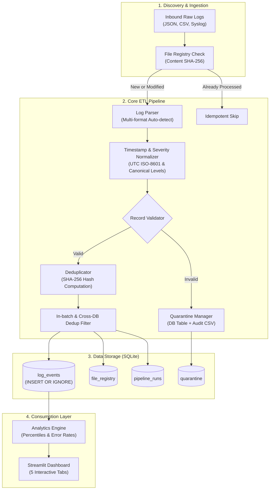
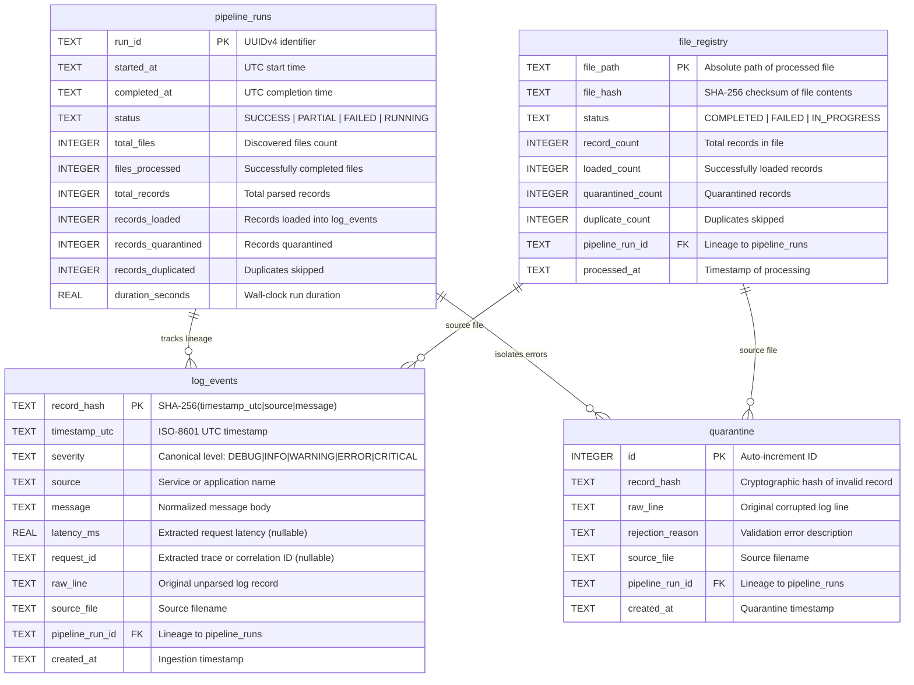

# LogPulse – Architecture & Technical Design

## 1. Executive Summary

LogPulse is an enterprise-grade log ingestion, processing, and analytical pipeline. Designed to handle diverse log formats emitted by distributed microservices, LogPulse standardizes temporal and severity attributes, guarantees exactly-once processing via cryptographic hashing, routes invalid records into quarantine, and populates an analytical data warehouse.

---

## 2. Architecture Overview

---

## 3. Database Schema Design

The storage layer utilizes SQLite with Write-Ahead Logging (WAL) and enforced foreign key constraints.

---

## 4. Key Design Decisions

1. **Deterministic Record Hashing (`SHA-256`)**:
   - `record_hash = sha256(f"{timestamp_utc}|{source}|{message}")`
   - Serves as the primary key of `log_events`.
   - Guarantees natural idempotency without requiring distributed lock managers or synthetic primary keys.

2. **Multi-Layer Idempotency**:
   - **File-Level**: Checksum inspection in `file_registry` prevents redundant processing of untouched files.
   - **Batch-Level**: Drops intra-file duplicate logs in memory before DB interaction.
   - **Storage-Level**: `INSERT OR IGNORE` acts as the safety net against race conditions or overlapping batches.

3. **Data Quality & Quarantine Routing**:
   - Malformed records do not abort the pipeline.
   - Invalid records are enriched with granular `rejection_reason` metadata and routed to the `quarantine` table and CSV audit logs.

4. **Zero-Overhead Local Stack**:
   - Standard Python, Pandas, SQLite, and Streamlit deliver 3,000+ records/second on local developer workstations without complex external infrastructure setup.
