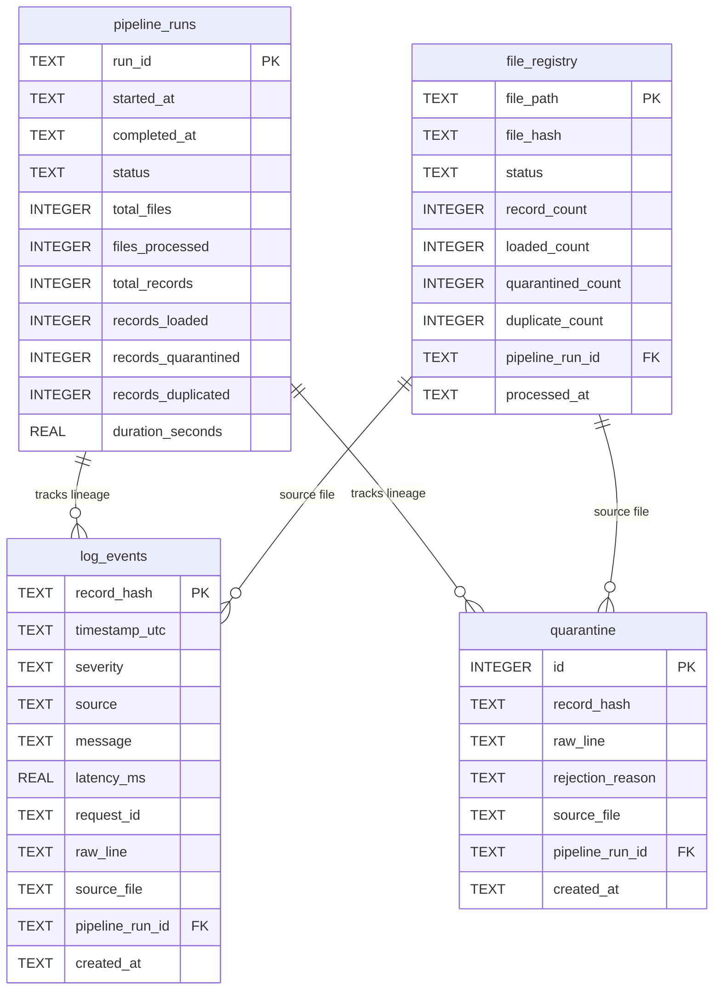

# LogPulse – Data Dictionary

This document details the database schema, table structures, column definitions, data types, constraints, and relationships in the SQLite database (`db/logpulse.db`), as implemented in `src/loader/db_loader.py`.

---

## 1. Entity-Relationship Overview

---

## 2. Table: `log_events`

The primary fact table storing parsed, normalized, validated, and deduplicated log records.

| Column Name | Data Type | Nullable | Constraint / Default | Description |
|---|---|---|---|---|
| `record_hash` | `TEXT` | No | `PRIMARY KEY` | Deterministic SHA-256 hash computed over `timestamp_utc\|source\|message`. Serves as primary key for hardware-level deduplication. |
| `timestamp_utc` | `TEXT` | No | None | Normalized event timestamp in UTC ISO-8601 format (`YYYY-MM-DDTHH:MM:SSZ` or with microseconds). |
| `severity` | `TEXT` | No | None | Standardized severity level. One of: `DEBUG`, `INFO`, `WARNING`, `ERROR`, `CRITICAL`. |
| `source` | `TEXT` | No | None | Originating microservice, application, or system component (e.g., `auth-service`, `api-gateway`). |
| `message` | `TEXT` | No | None | Cleaned log message body. |
| `latency_ms` | `REAL` | Yes | None | Extracted request/response duration in milliseconds. Extracted via regex or JSON key. Nullable if not present in log. |
| `request_id` | `TEXT` | Yes | None | Trace, correlation, or request identifier (e.g., `req-abc12345`). Nullable. |
| `raw_line` | `TEXT` | Yes | None | Original unparsed log line as read from the source file, preserved for debugging and auditing. |
| `source_file` | `TEXT` | No | None | Basename of the file from which this log record was ingested. |
| `pipeline_run_id` | `TEXT` | No | `FOREIGN KEY → pipeline_runs(run_id)` | UUID of the pipeline run that ingested this record. |
| `created_at` | `TEXT` | No | None | ISO-8601 UTC timestamp recording when this row was inserted into the database. |

### Indexes on `log_events`
- `sqlite_autoindex_log_events_1`: Unique index on `record_hash` (`PRIMARY KEY`).
- `idx_log_events_timestamp`: Index on `timestamp_utc` for time-series range scans and interval aggregations.
- `idx_log_events_severity`: Index on `severity` for error-rate filtering and breakdown queries.
- `idx_log_events_source`: Index on `source` for per-service aggregation queries.
- `idx_log_events_run_id`: Index on `pipeline_run_id` for lineage tracing.

---

## 3. Table: `quarantine`

Stores records that failed data validation, structural parsing, or required field checks.

| Column Name | Data Type | Nullable | Constraint / Default | Description |
|---|---|---|---|---|
| `id` | `INTEGER` | No | `PRIMARY KEY AUTOINCREMENT` | Auto-incrementing unique identifier for each quarantined entry. |
| `record_hash` | `TEXT` | Yes | None | SHA-256 hash computed over `raw_line\|rejection_reason` for quarantine event tracking. |
| `raw_line` | `TEXT` | Yes | None | The complete raw, unparsed line or reconstructed corrupted payload. |
| `rejection_reason` | `TEXT` | No | None | Semicolon-separated descriptions of validation failures (e.g., `Missing required field: timestamp; Unrecognized or disallowed severity: 'UNKNOWN'`). |
| `source_file` | `TEXT` | No | None | Filename from which the rejected record originated. |
| `pipeline_run_id` | `TEXT` | No | `FOREIGN KEY → pipeline_runs(run_id)` | UUID of the pipeline run during which the rejection occurred. |
| `created_at` | `TEXT` | No | None | ISO-8601 UTC timestamp recording when the record was quarantined. |

### Indexes on `quarantine`
- `idx_quarantine_run_id`: Index on `pipeline_run_id` for run-specific error reporting.

---

## 4. Table: `file_registry`

Ingestion ledger maintaining state and checksums of processed files to ensure file-level idempotency.

| Column Name | Data Type | Nullable | Constraint / Default | Description |
|---|---|---|---|---|
| `file_path` | `TEXT` | No | `PRIMARY KEY` | Absolute canonical filesystem path of the log file. |
| `file_hash` | `TEXT` | No | None | Cryptographic SHA-256 checksum of the entire file content. |
| `status` | `TEXT` | No | None | Processing state: `COMPLETED`, `FAILED`, or `IN_PROGRESS`. |
| `record_count` | `INTEGER` | Yes | `DEFAULT 0` | Total number of raw lines in the file. |
| `loaded_count` | `INTEGER` | Yes | `DEFAULT 0` | Count of records successfully inserted into `log_events`. |
| `quarantined_count` | `INTEGER` | Yes | `DEFAULT 0` | Count of records sent to quarantine. |
| `duplicate_count` | `INTEGER` | Yes | `DEFAULT 0` | Count of duplicate records skipped (in-batch + cross-DB). |
| `pipeline_run_id` | `TEXT` | Yes | `FOREIGN KEY → pipeline_runs(run_id)` | UUID of the pipeline execution that processed this file. |
| `processed_at` | `TEXT` | No | None | ISO-8601 UTC timestamp when the file processing concluded. |

### Indexes on `file_registry`
- `sqlite_autoindex_file_registry_1`: Unique index on `file_path` (`PRIMARY KEY`).

---

## 5. Table: `pipeline_runs`

Audit log recording performance metrics, row counters, status, and execution duration for every pipeline run.

| Column Name | Data Type | Nullable | Constraint / Default | Description |
|---|---|---|---|---|
| `run_id` | `TEXT` | No | `PRIMARY KEY` | Unique UUIDv4 assigned to each pipeline execution. |
| `started_at` | `TEXT` | No | None | ISO-8601 UTC timestamp marking when the pipeline began. |
| `completed_at` | `TEXT` | Yes | None | ISO-8601 UTC timestamp marking when the pipeline finished. |
| `status` | `TEXT` | No | None | Final run status: `SUCCESS`, `PARTIAL`, `FAILED`, or `RUNNING`. |
| `total_files` | `INTEGER` | Yes | `DEFAULT 0` | Total number of eligible files discovered for ingestion. |
| `files_processed` | `INTEGER` | Yes | `DEFAULT 0` | Number of files successfully processed without fatal aborts. |
| `total_records` | `INTEGER` | Yes | `DEFAULT 0` | Total raw records parsed across all files. |
| `records_loaded` | `INTEGER` | Yes | `DEFAULT 0` | Total rows inserted into `log_events`. |
| `records_quarantined` | `INTEGER` | Yes | `DEFAULT 0` | Total records diverted to `quarantine`. |
| `records_duplicated` | `INTEGER` | Yes | `DEFAULT 0` | Total duplicate records skipped across all files. |
| `duration_seconds` | `REAL` | Yes | `DEFAULT 0.0` | Total wall-clock execution duration in seconds. |

### Indexes on `pipeline_runs`
- `sqlite_autoindex_pipeline_runs_1`: Unique index on `run_id` (`PRIMARY KEY`).
